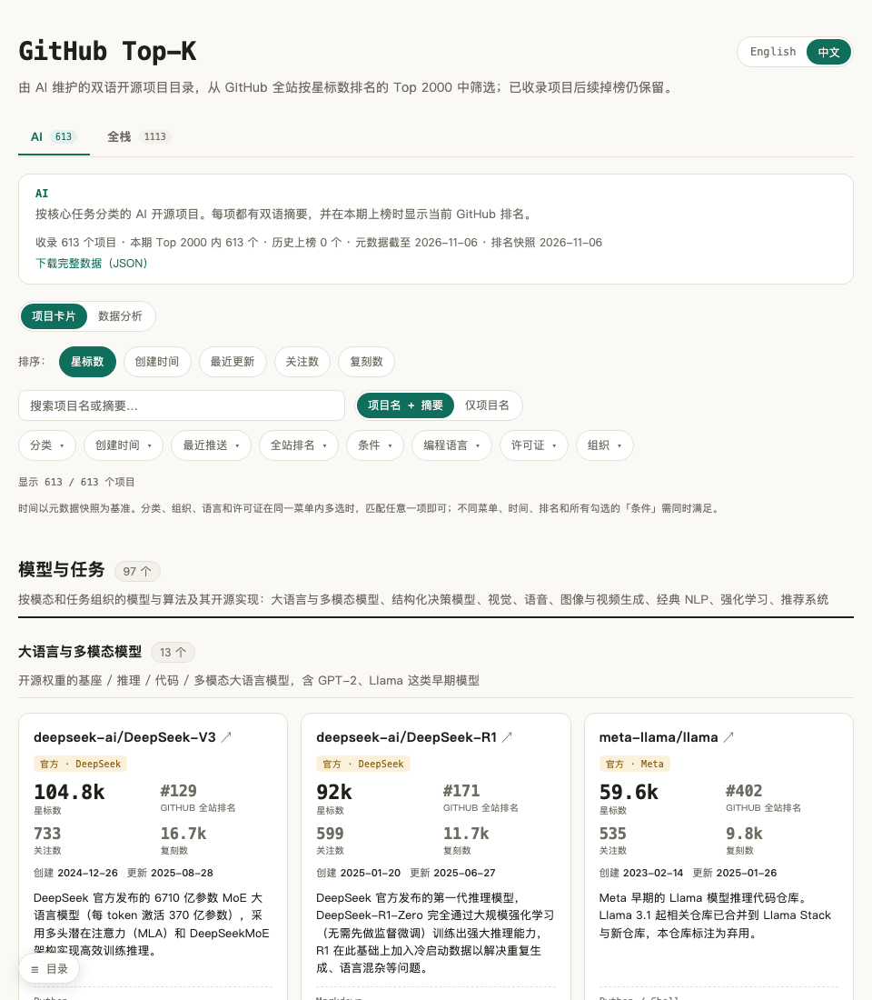
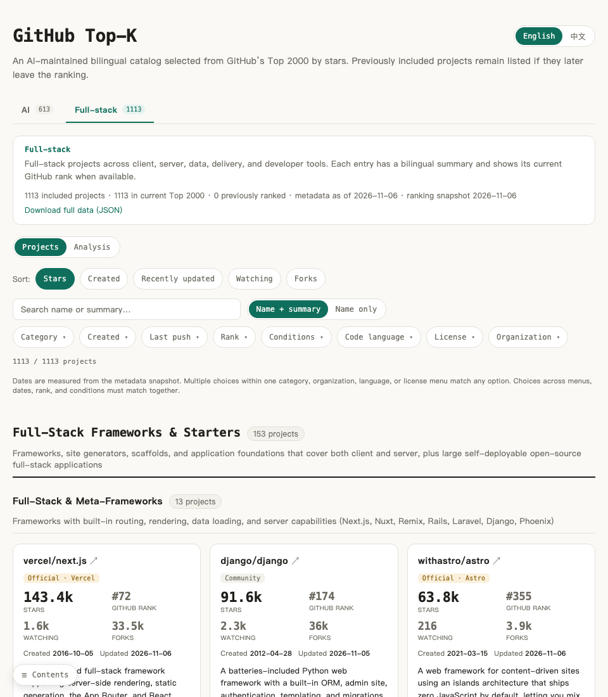

# GitHub Top-K

[简体中文](README.zh-CN.md)

[Visit the website](https://sigangluo.github.io/github-topk/)

GitHub Top-K is a bilingual open-source project catalog. It selects **AI** and **full-stack development** projects from a snapshot of GitHub's global Top K repositories by stars, organizes them by primary purpose, and gives each project a concise Chinese and English summary. AI maintains the catalog under maintainer review. Distinct categories, clear summaries, and accurate project placement are its priorities.

The two catalogs are selections from the global Top K, so their combined project count does not equal K. Projects in the current snapshot show their current rank. Previously included projects that later leave the Top K remain listed with a historical badge, without an invented former rank. Cards show GitHub metadata; the ranking and metadata snapshot dates appear at the top of the page.

## Screenshots

These images show the interface; use the website for the current data snapshot.

**AI catalog (Chinese)**



**Full-stack catalog (English)**



## Use the catalog

1. Switch between the **AI** and **Full-stack** tabs. Read the major and subcategory definitions, then the card summaries; categories describe each project's primary deliverable.
2. Search names or summaries, or choose **Name only** to exclude summary matches. Filter by category, creation date, last push, current rank, organization, language, license identifier, or repository conditions. Card sorting is available separately.
3. Open **Analysis** to compare time, language, and category distributions for the current filters. Analysis includes only projects still ranked in the current Top K; the card list includes every cataloged project.
4. Open a card's title for its GitHub repository. A declared website has its own link. Catalog-written project notes appear at the bottom right of the card, are labeled by language, and open in a dialog on the current page. The page also offers a full JSON download.

An **Official** badge identifies repository ownership, not project quality. Website links are declared by repositories; languages, stars, watching, forks, and license identifiers come from GitHub. A license identifier helps with discovery but does not replace checking the actual license. Relative date filters use the saved metadata snapshot, so results do not change between updates.

## Preview locally

From the repository root, run:

```bash
python3 -m http.server -d site 8000
```

Open `http://localhost:8000/`. No build step is needed. Opening the HTML file directly usually prevents the browser from loading its local JSON data.

## Data and feedback

[`data/ranking.json`](data/ranking.json) is the global ranking snapshot. [`data/ai/`](data/ai/) and [`data/fullstack/`](data/fullstack/) hold the taxonomies and project records. [`data/excluded.json`](data/excluded.json) records current Top K repositories outside both catalogs. Project notes are organized by language under [`notes/zh/`](notes/zh/) and [`notes/en/`](notes/en/). The site uses [`site/data/catalog.json`](site/data/catalog.json), generated from these sources and GitHub metadata; it is also downloadable from the page.

For a category boundary, project placement, or summary correction, provide the repository link, current text, proposed change, and supporting README or documentation evidence. Maintainer review and update instructions are in the root [`AGENTS.md`](AGENTS.md).

Code is [MIT licensed](LICENSE). Curated data and original summaries are [CC BY 4.0 licensed](data/LICENSE).
