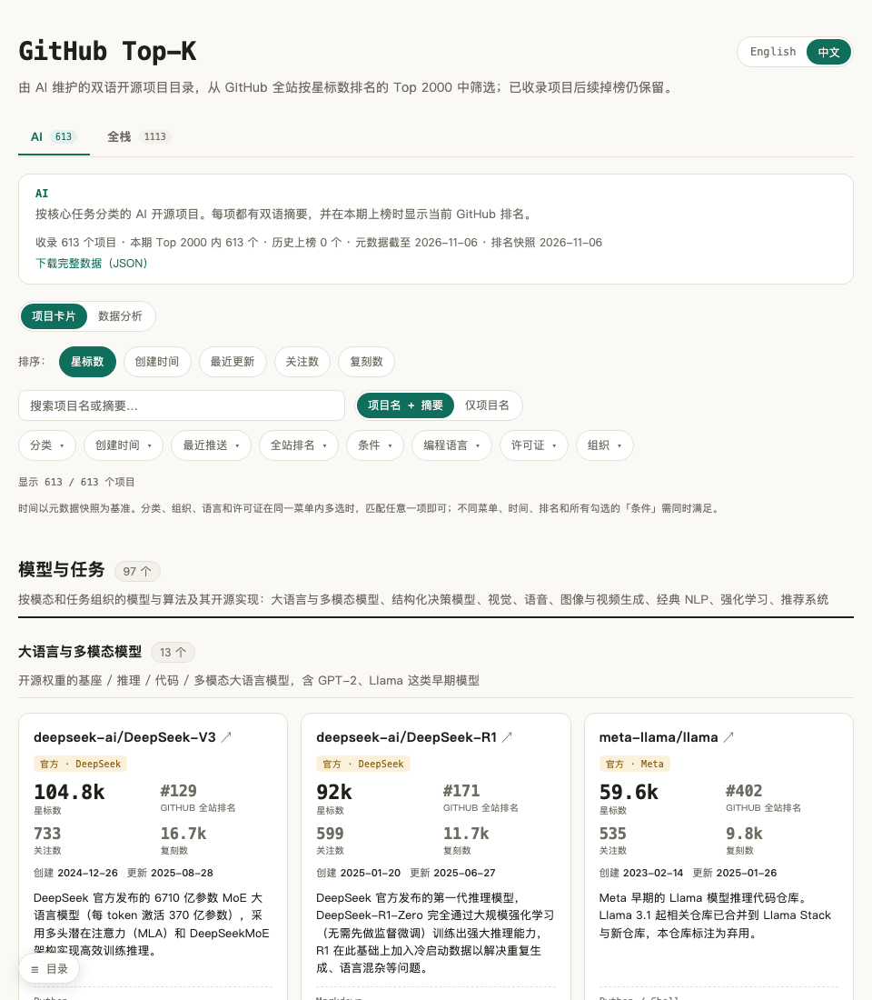
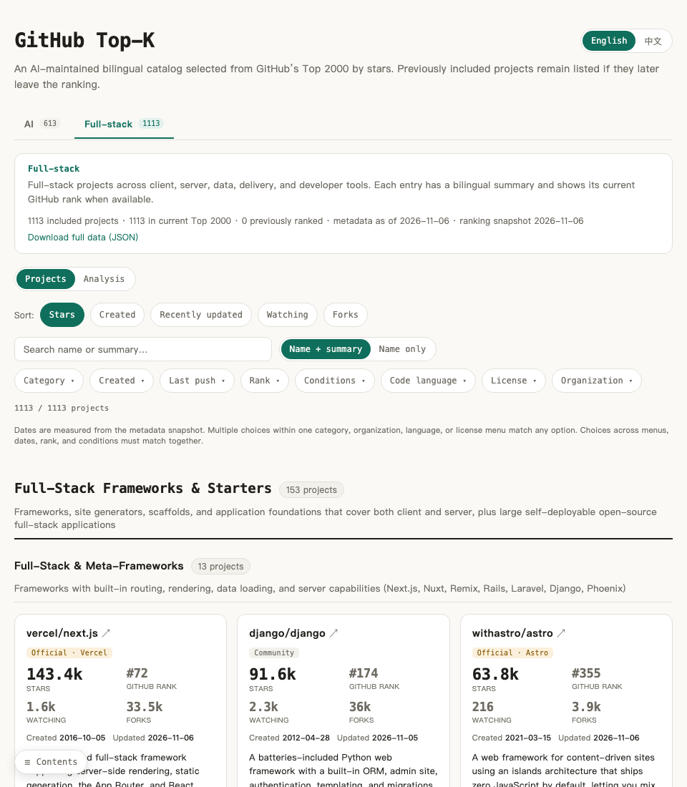

# GitHub Top-K

[English](README.md)

[访问网站](https://sigangluo.github.io/github-topk/)

GitHub Top-K 是一个双语开源项目目录：从 GitHub 全站按星标数排序的 Top K 快照中，挑选 **AI** 和 **全栈开发** 项目，按核心用途分类，并为每个项目提供能直接说明其用途的中英文摘要。项目由 AI 维护、维护者审核；分类的区分度、摘要的清晰度和项目归属的准确性是维护重点。

这里的两个榜单是全站 Top K 的领域筛选结果，因此收录数不会等于 K。进入本期 Top K 的项目显示快照中的当前排名；已经收录、此后掉榜的项目继续保留并标为「历史上榜」，不显示虚构的历史名次。项目卡片显示 GitHub 元数据，排名和元数据的快照日期见页面顶部。

## 页面预览

以下截图展示界面布局；项目数据以网站当前快照为准。

**AI 榜单（中文）**



**全栈榜单（英文）**



## 如何使用

1. 在 **AI** 和 **全栈** 标签间切换。先读大类与小类定义，再查看卡片摘要；分类说明的是项目的核心交付物。
2. 用搜索框查项目名或摘要；选择「仅项目名」可排除摘要匹配。还可按分类、创建时间、最近推送、当前排名、组织、语言、许可证标识和仓库条件筛选，并调整卡片排序。
3. 切换到「数据分析」查看当前筛选结果的时间、语言和分类分布。分析只统计本期仍在 Top K 内的项目，卡片清单则展示全部已收录项目。
4. 点击卡片标题进入 GitHub 仓库；有官网时显示独立的官网链接。本站撰写的逐项目笔记位于卡片右下角，按语言标明，点击后在当前页面弹窗展示。页面提供完整 JSON 数据下载。

卡片上的「官方」表示仓库归属，并非质量保证。官网来自仓库声明；语言、星标数、关注数、复刻数和许可证标识来自 GitHub。许可证标识仅供检索，不能代替实际许可证核对。相对时间筛选以保存的元数据快照为准，不随访问日期变化。

## 本地预览

在项目根目录运行：

```bash
python3 -m http.server -d site 8000
```

打开 `http://localhost:8000/`。站点无需构建；直接双击 HTML 时，浏览器通常会阻止读取本地 JSON。

## 数据与反馈

[`data/ranking.json`](data/ranking.json) 是全站排名快照；[`data/ai/`](data/ai/) 和 [`data/fullstack/`](data/fullstack/) 保存分类与项目资料；[`data/excluded.json`](data/excluded.json) 记录当前 Top K 内未纳入两个方向的项目。逐项目说明按语言存放在 [`notes/zh/`](notes/zh/) 和 [`notes/en/`](notes/en/)。网页使用 [`site/data/catalog.json`](site/data/catalog.json)，它由前述资料和 GitHub 元数据生成，亦可在网页下载。

如果发现分类边界、项目归属或摘要有误，欢迎提供仓库链接、现有内容、建议修改和 README／文档依据。维护者的审核与更新流程见根目录的 [`AGENTS.md`](AGENTS.md)。

源码使用 [MIT 许可](LICENSE)；整理的数据与原创摘要使用 [CC BY 4.0](data/LICENSE)。
